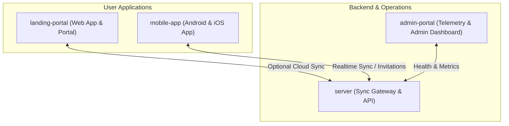

# Bonton Monorepo (বণ্টন) 🌐📱⚙️📊

> **Bonton (বণ্টন)** is a modern, local-first, privacy-friendly ecosystem designed to simplify group expense sharing, optimize debt settlement, and manage shared financial balances across Web, Mobile, and Cloud.

<p align="left">
  
  
  
  
  
  
  
</p>

---

## 🏛️ Ecosystem Overview



---

## 📦 Packages & Applications

| App / Package | Description | Core Stack | Status |
| :--- | :--- | :--- | :--- |
| **[`landing-portal`](./landing-portal)** | Official web application, marketing portal, and local-first browser client | Next.js 16, React 19, Tailwind CSS v4, Zustand | 🟢 Production Ready |
| **[`mobile-app`](./mobile-app)** | Native cross-platform mobile client for Android & iOS | React Native 0.88, Expo SDK 58, Unistyles v3, Bun | 🚀 In Active Development |
| **[`server`](./server)** | Optional cloud synchronization, WebSocket relay, and group invite gateway | Node.js / Bun, Hono / Fastify, PostgreSQL / Redis | 🛠️ In Scaffold Phase |
| **[`admin-portal`](./admin-portal)** | Internal monitoring, telemetry, error audits, and feature flag management | Next.js 16 / React 19, Tailwind CSS v4, shadcn/ui | 🛠️ In Scaffold Phase |

---

## 📁 Repository Structure

```text
bonton-monorepo/
├── landing-portal/       # Next.js 16 + React 19 web app and browser client
├── mobile-app/           # React Native + Expo SDK 58 mobile app (Android & iOS)
├── server/               # Cloud sync gateway, WebSocket relay & backend service
├── admin-portal/         # Administration, health monitoring & metrics dashboard
├── package.json          # Root monorepo workspace configuration
├── pnpm-workspace.yaml   # pnpm workspace definition
└── README.md             # Monorepo documentation
```

---

## 💡 Core Philosophy & Design Principles

1. **Local-First & Zero Knowledge**: Users can immediately track expenses and calculate settlements without mandatory accounts or server connections. All core logic runs directly on client devices.
2. **Integer Math (Cents / Poisha)**: All currency calculations are executed in integer cents/poisha to eliminate floating-point inaccuracies.
3. **Greedy Debt Minimization**: Groups of any size can settle debts with the absolute minimum number of financial transfers (`A pays B ৳500`).
4. **5 Unified Themes**: Light (Emerald), Dark (Slate/Mint), Sepia (Warm Paper), Forest (Natural Green), and Ocean (Marine Blue) shared across all client platforms.
5. **Bilingual by Design**: Seamless real-time switching between Bengali (বাংলা) and English (EN) with multi-currency formatting (`৳`, `$`, `€`, `£`, `₹`).

---

## 🚀 Getting Started

### Prerequisites
- **Node.js**: `v20.x` or later (`v24.x` recommended)
- **pnpm**: `v10.x` or later (`v12.x` recommended)
- **Bun**: `v1.2+` (recommended for `mobile-app` and fast execution)

### 1. Installation

```bash
# Clone the repository
git clone git@github.com:AbdullahAlMaksud/bonton-monorepo.git
cd bonton-monorepo

# Install dependencies for workspace packages
pnpm install
```

### 2. Running Individual Apps

```bash
# Run web client (landing-portal)
pnpm dev

# Run mobile app
cd mobile-app
bun install
bun run start

# Run server backend
cd server
pnpm dev

# Run admin dashboard
cd admin-portal
pnpm dev
```

---

## 🤝 Contributing

Contributions are welcome! Please ensure:
- All financial balance logic adheres to integer-based calculations.
- Code conforms to ESLint, Prettier, and TypeScript strict checks.
- Translations exist for both Bengali and English locales.

---

## 📄 License

This project is licensed under the [MIT License](./landing-portal/README.md#license).
