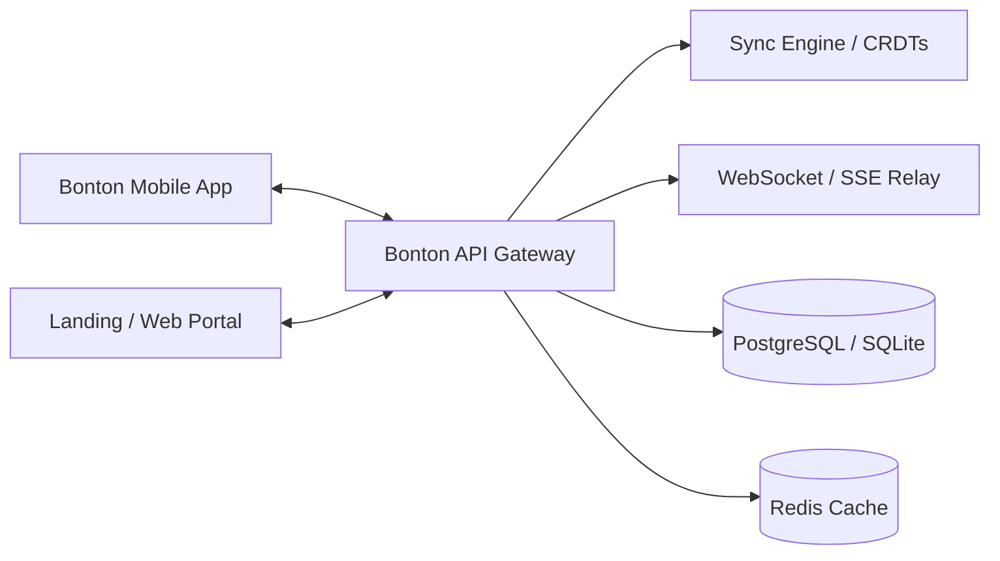

# Bonton Server (বণ্টন সার্ভার) ⚙️

The backend synchronization engine, API service, and real-time collaboration gateway for the **Bonton (বণ্টন)** ecosystem.

---

## 🌟 Overview

While Bonton is fundamentally designed with a **local-first** approach, **Bonton Server** provides optional cloud sync, multi-device backup, and real-time group collaboration. It enables multiple users to join the same group via invite links or QR codes, updating expenses in real-time while preserving user privacy through zero-knowledge or encrypted vault synchronization.

---

## 🛠️ Architecture & Capabilities



### Core Responsibilities
- **Hybrid Local-First Synchronization**: Reconciles offline state changes using Conflict-free Replicated Data Types (CRDTs) or version vectors.
- **Real-Time Group Updates**: WebSocket / Server-Sent Events (SSE) relay for live group notifications and balance updates.
- **Group Invitations & Link Sharing**: Generates secure shareable invite links and dynamic QR codes for joining groups.
- **Encrypted Group Vaults**: Zero-knowledge encryption support ensuring financial logs are decrypted only by members with the group key.
- **PDF & Receipt Rendering Microservice**: Headless server-side export generation for high-density balance sheets and summaries.

---

## 💻 Tech Stack

| Component | Technology | Description |
| :--- | :--- | :--- |
| **Runtime** | [Node.js](https://nodejs.org/) / [Bun](https://bun.sh/) | High-performance TypeScript execution |
| **Framework** | [Hono](https://hono.dev/) / [Fastify](https://fastify.dev/) | Ultra-fast, lightweight API framework |
| **Database** | [PostgreSQL](https://www.postgresql.org/) (with Prisma / Drizzle ORM) | Structured relation storage |
| **Caching & Pub/Sub** | [Redis](https://redis.io/) | In-memory message broker for real-time sync |
| **Authentication** | JWT / Magic Links (Optional) | Passwordless, privacy-respecting auth |
| **Validation** | [Zod](https://zod.dev/) | End-to-end type-safe schema validation |

---

## 📁 Directory Structure

```text
server/
├── src/
│   ├── config/               # Environment variables and system configuration
│   ├── modules/              # Modular domain features
│   │   ├── auth/             # Anonymous session & magic link authentication
│   │   ├── groups/           # Group management & member permissions
│   │   ├── expenses/         # Expense logging & batch updates
│   │   ├── sync/             # Offline reconciliation & change streams
│   │   └── export/           # Document generation service
│   ├── realtime/             # WebSocket connections and room pub/sub
│   ├── database/             # Prisma/Drizzle schema, migrations, seeders
│   └── shared/               # Global utilities, error handling, middlewares
├── .env.example              # Environment variables template
├── package.json              # Service dependencies and scripts
└── tsconfig.json             # TypeScript configuration
```

---

## 🚀 Getting Started

### Prerequisites
- Node.js `20.x` or later (or Bun `1.2+`)
- PostgreSQL (or SQLite for local development)
- Redis (optional for single-instance development)

### Quick Start

```bash
# 1. Install dependencies
pnpm install # or bun install

# 2. Configure environment
cp .env.example .env

# 3. Run database migrations
pnpm db:migrate

# 4. Start in development mode
pnpm dev

# 5. Build for production
pnpm build
pnpm start
```

---

## 🔒 Privacy & Security

- **Zero Unnecessary Telemetry**: No tracking of personal identities, contact lists, or unencrypted financial totals.
- **Rate-Limiting & DDOS Protection**: Strict limits on invite link resolution and public API requests.
- **Integer Cents Standard**: Matches mobile and web client standard for accurate balance reconciliation.

---

## 📄 License
MIT License
